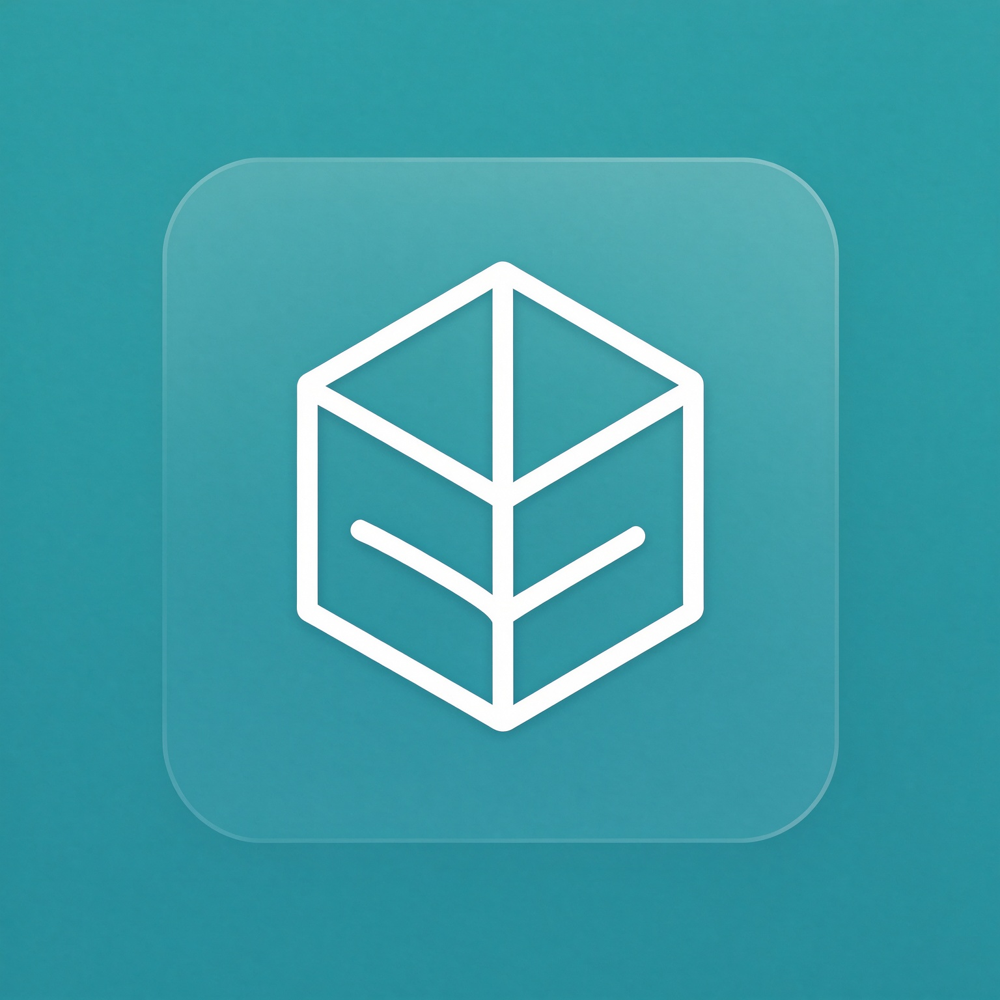
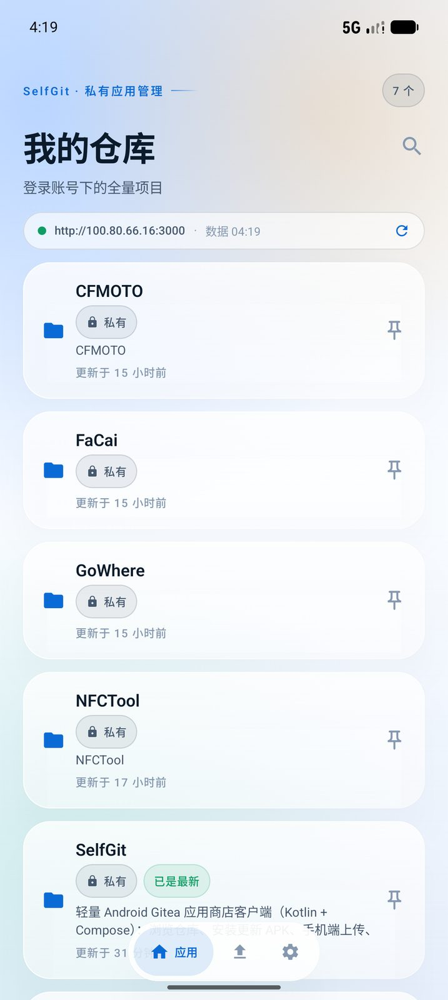
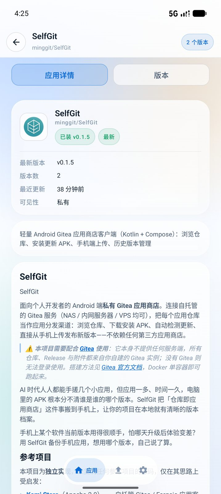
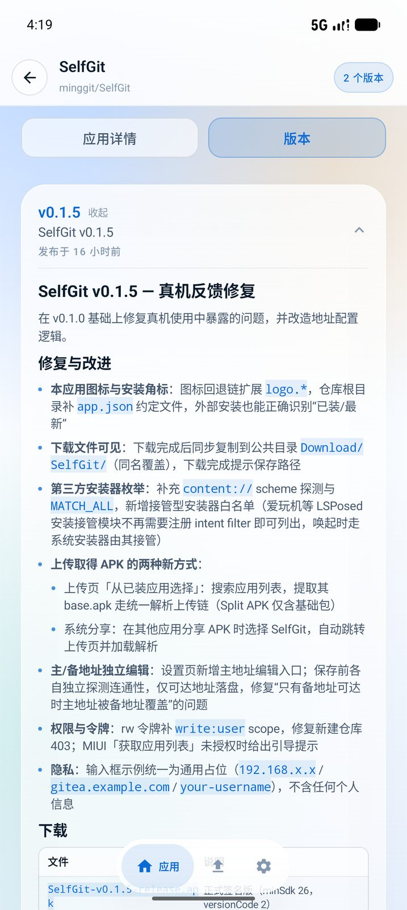
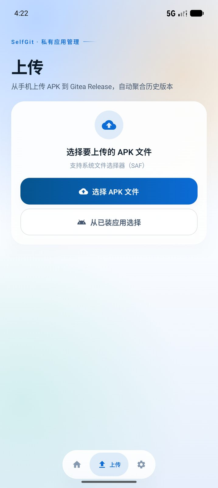
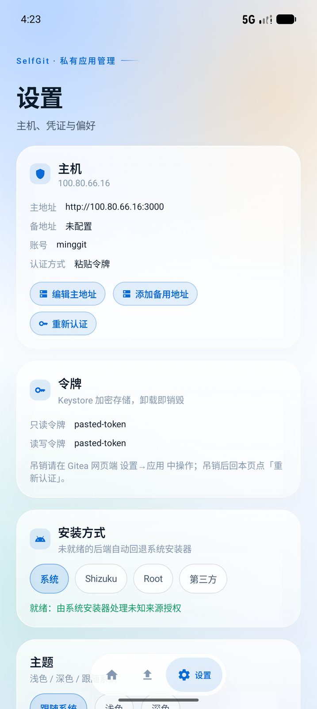
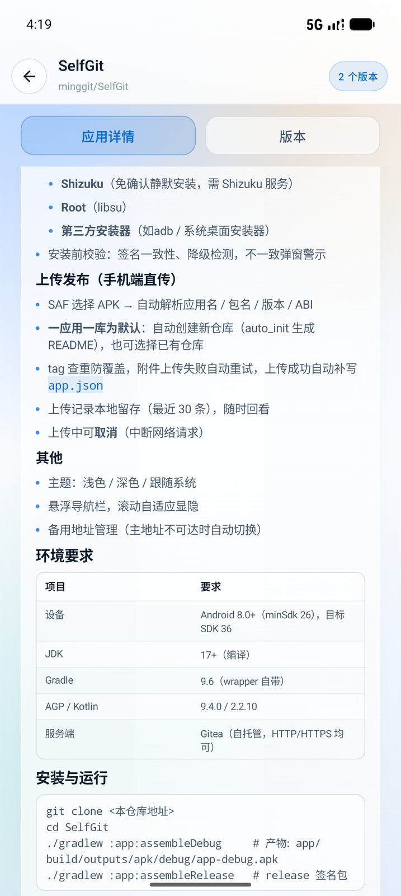
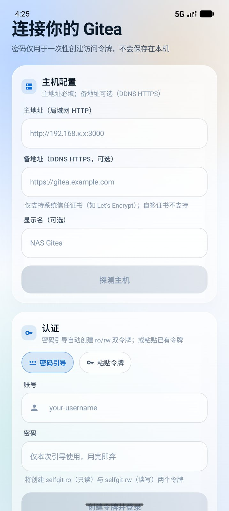

# SelfGit

<p align="center">
  
</p>
面向个人开发者的 Android 端**私有 Gitea 应用商店**。连接自托管的 Gitea 服务（NAS / 内网服务器 / VPS 均可），把每个应用仓库当作应用分发渠道：浏览仓库、下载安装 APK、自动检测更新、直接从手机上传发布新版本——不依赖任何第三方应用商店。

> **⚠️ 本项目需要配合 [Gitea](https://about.gitea.com/) 使用**：它本身不提供任何服务端，所有仓库、Release 与附件都来自你自建的 Gitea 实例；没有 Gitea 则无法登录使用。搭建方法见 [Gitea 官方文档](https://docs.gitea.com/)，Docker 单容器即可跑起来。

AI 时代人人都能手搓几个小应用，但应用一多、时间一久，电脑里的 APK 根本分不清谁是谁的哪个版本。SelfGit 把「仓库即应用商店」这件事搬到手机上，让你的项目在本地就有清晰的版本档案。

手机上某个软件当前版本用得很顺手，怕哪天升级后体验变差？用 SelfGit 备份手机应用，想用哪个版本，自己说了算。

## 界面预览

<p align="center">
  
  
  
  
  <br/>
  
  
  
</p>

## 参考项目

本项目为**独立实现**，未复制任何参考项目的源码，仅在其思路上受启发：

- **[Komi Store](https://github.com/komi-store/komi-store)**（Apache-2.0）—— 自托管 Gitea / Forgejo 应用客户端，本项目的调研起点；其强制 HTTPS 与自托管 HTTP 场景不兼容，促使 SelfGit 独立实现
- **[Obtainium](https://github.com/ImranR98/Obtainium)**（GPL-3.0）—— 自定义来源应用更新的交互与追踪思路参考

## 功能特性

### 账号与安全
- **混合登录**：账号密码引导自动创建只读 + 读写双令牌，密码只是首次创建令牌使用，后续无需使用，也可以手动创建令牌直接粘贴，免输密码
- 令牌经 Android **Keystore 加密**存储，密码不落盘；主备双地址自动切换
- 一键清除全部数据（弹窗二次确认，须输入「确认清除」）

### 仓库浏览
- 仓库列表：关键词搜索（默认隐藏，标题行放大镜呼出）、**置顶/取消置顶**
- 更新角标：自动对比最新 Release 与本机已装版本（「已是最新 / 有更新 vX.Y.Z」）
- **外部安装识别**：仓库根目录放置 `app.json`（`{"packageName": "..."}`），非经本应用安装的 APK 也能显示角标
- 仓库详情：**应用详情 / 版本**双板块切换；README 渲染；应用图标三级回退（本机已装 → 仓库 avatar / 根目录 `icon.png` → 占位符）
- 版本时间线折叠展开，更新说明支持 Markdown 渲染

### 下载与安装
- 附件两段式下载，失败重试，安装方式四选一：
  - **系统安装器**（默认，弹未知来源授权，如果已使用root将系统安装器设置为第三方，直接选择系统即可）
  - **Shizuku**（免确认静默安装，需 Shizuku 服务）
  - **Root**（libsu）
  - **第三方安装器**（如adb / 系统桌面安装器）
- 安装前校验：签名一致性、降级检测，不一致弹窗警示

### 上传发布（手机端直传）
- SAF 选择 APK → 自动解析应用名 / 包名 / 版本 / ABI
- **一应用一库为默认**：自动创建新仓库（auto_init 生成 README），也可选择已有仓库
- tag 查重防覆盖，附件上传失败自动重试，上传成功自动补写 `app.json`
- 上传记录本地留存（最近 30 条），随时回看
- 上传中可**取消**（中断网络请求）

### 其他
- 主题：浅色 / 深色 / 跟随系统
- 悬浮导航栏，滚动自适应显隐
- 备用地址管理（主地址不可达时自动切换）

## 环境要求

| 项目 | 要求 |
|---|---|
| 设备 | Android 8.0+（minSdk 26），目标 SDK 36 |
| JDK | 17+（编译） |
| Gradle | 9.6（wrapper 自带） |
| AGP / Kotlin | 9.4.0 / 2.2.10 |
| 服务端 | Gitea（自托管，HTTP/HTTPS 均可） |

## 安装与运行

```bash
git clone <本仓库地址>
cd SelfGit
./gradlew :app:assembleDebug     # 产物: app/build/outputs/apk/debug/app-debug.apk
./gradlew :app:assembleRelease   # release 签名包
```

或用 Android Studio（Ladybug+，支持 AGP 9）打开工程直接运行。

首次启动在登录页填写 Gitea 地址与账号密码（或粘贴已有令牌），登录成功后自动拉取仓库列表。

## 使用说明

1. **登录**：主机页填入 Gitea 地址（如 `http://192.168.x.x:3000`）与账号密码 → 自动探测 → 创建双令牌
2. **浏览**：主页仓库列表支持搜索与置顶；带「有更新 vX」角标的仓库即有新版本
3. **安装**：进入仓库 → 版本板块 → 点 APK 附件「下载」→ 完成后点「安装」；安装方式可在设置页切换
4. **上传**：底部导航「上传」→ 选择 APK 文件 → 默认自动新建仓库（一应用一库）→ 填写 tag 与更新说明 → 上传
5. **更新检测**：应用每次刷新时对比仓库最新 tag 与本机已装版本；外部安装的应用通过仓库 `app.json` 识别

### 仓库约定文件

| 文件 | 作用 |
|---|---|
| `app.json` | `{"packageName": "com.example.app", "displayName": "显示名"}`，用于外部安装的更新检测（上传时自动补写） |
| `icon.png`（或 jpg/webp） | 仓库根目录应用图标（本机未安装该应用时详情页显示） |
| README.md | 仓库详情页「应用详情」板块渲染 |

## 目录结构

```
SelfGit/
├── app/src/main/
│   ├── java/com/selfgit/app/
│   │   ├── net/            # GiteaClient（API 封装）、InstallRouter（安装后端路由）、ApkInstaller（解析/校验）
│   │   ├── data/           # SettingsStore、TrackingStore、PinnedStore、UploadHistoryStore（本地持久化）
│   │   ├── shell/          # Shizuku UserService（AIDL）执行 shell 命令
│   │   └── ui/
│   │       ├── components/ # 玻璃体系组件（GlassPanel/GlassBadge/MarkdownText/GlassAlertDialog…）
│   │       ├── screens/    # 登录/仓库列表/仓库详情/上传/设置五个页面
│   │       ├── navigation/ # FloatingNavBar 悬浮导航
│   │       └── theme/      # 调色板与主题
│   ├── aidl/               # IShellService.aidl
│   └── res/                # mipmap 图标（logo.png 生成）、布局资源
├── docs/                   # 需求与技术设计文档、UI 设计文档
├── gradle/                 # wrapper 与版本目录（libs.versions.toml）
└── logo.png                # 应用图标源文件
```

## 配置说明

- **安装方式**（设置 → 安装方式）：系统 / Shizuku / Root / 第三方；Shizuku 未就绪时自动回退系统安装器
- **备用地址**（设置 → 主机 → 添加备用地址）：填写后主地址不可达时自动切换
- **主题**（设置 → 主题）：浅色 / 深色 / 跟随系统
- **网络**：应用允许明文 HTTP（自托管 NAS 常见场景），由 `network_security_config` 控制
- **权限**：`INTERNET`、`ACCESS_NETWORK_STATE`、`REQUEST_INSTALL_PACKAGES`、`QUERY_ALL_PACKAGES`（Android 11+ 包可见性，用于已装版本检测）

## 常见问题

**Q: 上传时报"仓库为空"？**
新仓库需要初始化（README）。SelfGit 自动建库时已带 auto_init；若使用网页端预先创建的空仓库，请在网页端初始化或改用"新建仓库"模式。

**Q: 选择手机已安装应用上传时列表为空？**
部分手机可能会拦截读取应用列表权限或返回空白值，给本应用授予权限即可。

**Q: 为什么外部安装的应用也能显示"有更新"？**
仓库根目录放了 `app.json`（含包名），应用刷新时用包名匹配本机已装版本。

**Q: Shizuku 安装不生效？**
确认 Shizuku 服务已启动且已授权本应用；未就绪时自动回退系统安装器。

**Q: 明文 HTTP 被拦截？**
本应用默认允许明文 HTTP（network_security_config）；如需收紧，编辑 `app/src/main/res/xml/network_security_config.xml`。

**Q: 更新提示了但安装失败，提示签名不一致？**
与本机已装应用的签名不同，需先卸载旧版；安装前弹窗会明确警示。

## 版本信息

### v0.1.5（2026-11-18）

体验与稳定性修复：

- 本应用图标与“已装”角标识别修复（图标回退支持 `logo.*`，仓库根目录 `app.json` 约定）
- 下载完成后同步到公共目录 `Download/SelfGit/`，文件管理器可见
- 第三方安装器枚举补全（`content://` 探测），新增接管型安装器白名单（如爱玩机）
- 上传页新增“从已装应用选择”，支持提取已安装应用的 base.apk 上传；支持接收系统分享的 APK（查看应用信息-分享-选择SelfGit）
- 主/备地址独立编辑与独立连通性探测，修复仅备地址可达时主地址被覆盖的问题
- 输入框示例改为通用占位（不含个人信息）；rw 令牌补 `write:user` scope，修复新建仓库 403

### v0.1.0（2026-11-18）

首个公开版本：

- 混合登录（密码引导双令牌 / 粘贴令牌）、主备地址
- 仓库列表（搜索 / 置顶 / 更新角标 / 外部安装识别）
- 仓库详情（应用详情 / 版本双板块、README 与 Markdown 渲染、图标三级回退）
- 下载安装（四安装后端 + 签名 / 降级校验）
- 手机端上传（SAF 选 APK、自动建库、tag 查重、上传记录、可取消）
- 数据管理（本地清除二次确认、上传历史留存）

## 许可

本项目基于 **[GNU General Public License v3.0 (GPLv3)](LICENSE)** 开源。

- ✅ 个人学习、研究、修改、自用完全自由
- ✅ 修改或衍生发布时，须同样以 GPLv3 开源并保留原许可声明
- 🚫 不允许以闭源形式分发本项目或其衍生版本

> 本项目仅供学习研究，不提供任何担保；使用中产生的风险由使用者自行承担。
